<picture>
  <source media="(prefers-color-scheme: dark)" srcset="https://raw.githubusercontent.com/tolgadydev/tolgadydev/main/dark.svg" />
  <source media="(prefers-color-scheme: light)" srcset="https://raw.githubusercontent.com/tolgadydev/tolgadydev/main/light.svg" />
  
</picture>

 

&nbsp;&nbsp;

  

<picture>
  <source media="(prefers-color-scheme: dark)" srcset="https://streak-stats.demolab.com/?user=tolgadydev&background=0A101F&border=1C2333&stroke=22D3EE&ring=A78BFA&fire=10B981&currStreakNum=E5E7EB&sideNums=E5E7EB&currStreakLabel=22D3EE&sideLabels=8B93A7&dates=586178&border_radius=8" />
  <source media="(prefers-color-scheme: light)" srcset="https://streak-stats.demolab.com/?user=tolgadydev&background=F6F8FA&border=D7DEE8&stroke=0891B2&ring=7C3AED&fire=10B981&currStreakNum=1F2937&sideNums=1F2937&currStreakLabel=0891B2&sideLabels=5B6472&dates=94A0B4&border_radius=8" />
  
</picture>

<picture>
  <source media="(prefers-color-scheme: dark)" srcset="https://github-readme-stats-jet-tau-86.vercel.app/api?username=tolgadydev&show_icons=true&hide_rank=true&bg_color=0A101F&title_color=22D3EE&icon_color=10B981&text_color=E5E7EB&border_color=1C2333&border_radius=8" />
  <source media="(prefers-color-scheme: light)" srcset="https://github-readme-stats-jet-tau-86.vercel.app/api?username=tolgadydev&show_icons=true&hide_rank=true&bg_color=F6F8FA&title_color=0891B2&icon_color=10B981&text_color=1F2937&border_color=D7DEE8&border_radius=8" />
  
</picture>
<picture>
  <source media="(prefers-color-scheme: dark)" srcset="https://github-readme-stats-jet-tau-86.vercel.app/api/top-langs/?username=tolgadydev&layout=compact&bg_color=0A101F&title_color=22D3EE&text_color=E5E7EB&border_color=1C2333&border_radius=8" />
  <source media="(prefers-color-scheme: light)" srcset="https://github-readme-stats-jet-tau-86.vercel.app/api/top-langs/?username=tolgadydev&layout=compact&bg_color=F6F8FA&title_color=0891B2&text_color=1F2937&border_color=D7DEE8&border_radius=8" />
  
</picture>

  

<a href="https://github.com/tolgadydev/YZTA-Bootcamp"><picture>
  <source media="(prefers-color-scheme: dark)" srcset="https://github-readme-stats-jet-tau-86.vercel.app/api/pin/?username=tolgadydev&repo=YZTA-Bootcamp&bg_color=0A101F&title_color=22D3EE&icon_color=A78BFA&text_color=E5E7EB&border_color=1C2333&border_radius=8" />
  <source media="(prefers-color-scheme: light)" srcset="https://github-readme-stats-jet-tau-86.vercel.app/api/pin/?username=tolgadydev&repo=YZTA-Bootcamp&bg_color=F6F8FA&title_color=0891B2&icon_color=7C3AED&text_color=1F2937&border_color=D7DEE8&border_radius=8" />
  
</picture></a>
<a href="https://github.com/tolgadydev/BookTracker-FastAPI-Project"><picture>
  <source media="(prefers-color-scheme: dark)" srcset="https://github-readme-stats-jet-tau-86.vercel.app/api/pin/?username=tolgadydev&repo=BookTracker-FastAPI-Project&bg_color=0A101F&title_color=22D3EE&icon_color=A78BFA&text_color=E5E7EB&border_color=1C2333&border_radius=8" />
  <source media="(prefers-color-scheme: light)" srcset="https://github-readme-stats-jet-tau-86.vercel.app/api/pin/?username=tolgadydev&repo=BookTracker-FastAPI-Project&bg_color=F6F8FA&title_color=0891B2&icon_color=7C3AED&text_color=1F2937&border_color=D7DEE8&border_radius=8" />
  
</picture></a>
<a href="https://github.com/tolgadydev/WDI-Education-Development"><picture>
  <source media="(prefers-color-scheme: dark)" srcset="https://github-readme-stats-jet-tau-86.vercel.app/api/pin/?username=tolgadydev&repo=WDI-Education-Development&bg_color=0A101F&title_color=22D3EE&icon_color=A78BFA&text_color=E5E7EB&border_color=1C2333&border_radius=8" />
  <source media="(prefers-color-scheme: light)" srcset="https://github-readme-stats-jet-tau-86.vercel.app/api/pin/?username=tolgadydev&repo=WDI-Education-Development&bg_color=F6F8FA&title_color=0891B2&icon_color=7C3AED&text_color=1F2937&border_color=D7DEE8&border_radius=8" />
  
</picture></a>
<a href="https://github.com/tolgadydev/Metro-Simulation"><picture>
  <source media="(prefers-color-scheme: dark)" srcset="https://github-readme-stats-jet-tau-86.vercel.app/api/pin/?username=tolgadydev&repo=Metro-Simulation&bg_color=0A101F&title_color=22D3EE&icon_color=A78BFA&text_color=E5E7EB&border_color=1C2333&border_radius=8" />
  <source media="(prefers-color-scheme: light)" srcset="https://github-readme-stats-jet-tau-86.vercel.app/api/pin/?username=tolgadydev&repo=Metro-Simulation&bg_color=F6F8FA&title_color=0891B2&icon_color=7C3AED&text_color=1F2937&border_color=D7DEE8&border_radius=8" />
  
</picture></a>
<a href="https://github.com/tolgadydev/Basic-GUI-Project"><picture>
  <source media="(prefers-color-scheme: dark)" srcset="https://github-readme-stats-jet-tau-86.vercel.app/api/pin/?username=tolgadydev&repo=Basic-GUI-Project&bg_color=0A101F&title_color=22D3EE&icon_color=A78BFA&text_color=E5E7EB&border_color=1C2333&border_radius=8" />
  <source media="(prefers-color-scheme: light)" srcset="https://github-readme-stats-jet-tau-86.vercel.app/api/pin/?username=tolgadydev&repo=Basic-GUI-Project&bg_color=F6F8FA&title_color=0891B2&icon_color=7C3AED&text_color=1F2937&border_color=D7DEE8&border_radius=8" />
  
</picture></a>
<a href="https://github.com/tolgadydev/Veri-Analizi-Projesi"><picture>
  <source media="(prefers-color-scheme: dark)" srcset="https://github-readme-stats-jet-tau-86.vercel.app/api/pin/?username=tolgadydev&repo=Veri-Analizi-Projesi&bg_color=0A101F&title_color=22D3EE&icon_color=A78BFA&text_color=E5E7EB&border_color=1C2333&border_radius=8" />
  <source media="(prefers-color-scheme: light)" srcset="https://github-readme-stats-jet-tau-86.vercel.app/api/pin/?username=tolgadydev&repo=Veri-Analizi-Projesi&bg_color=F6F8FA&title_color=0891B2&icon_color=7C3AED&text_color=1F2937&border_color=D7DEE8&border_radius=8" />
  
</picture></a>

  

<picture>
  <source media="(prefers-color-scheme: dark)" srcset="https://raw.githubusercontent.com/tolgadydev/tolgadydev/output/snake-dark.svg" />
  <source media="(prefers-color-scheme: light)" srcset="https://raw.githubusercontent.com/tolgadydev/tolgadydev/output/snake-light.svg" />
  
</picture>

